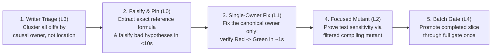

# Universal High-Speed Parity & Engineering Methodology

Status: Portable methodology synthesis (2026-11-13). For project-specific execution order in `mc-spine`, see [ROADMAP.md](../ROADMAP.md), [implementation-checklist.md](../implementation-checklist.md), and [investigation-workflow.md](../worldgen-parity/investigation-workflow.md).

---

## Purpose

When building a deterministic reimplementation, compiler, emulator, protocol engine, or high-precision port against a reference oracle, teams routinely lose 80%+ of their engineering time to **false feedback loops**: debugging symptoms instead of root writers, trusting tests that cannot fail, running 30-minute end-to-end builds to answer 1-second static questions, or getting fooled by missing data.

This document codifies **six foundational theories** and a **5-step convergence loop** that can be dropped into any engineering project to maximize convergence velocity while keeping verification fail-closed.

---

## Part I. Six Theoretical Pillars & Operational Laws

### 1. Survivorship Bias (Abraham Wald's Bullet Holes)

> **Law 1:** *Never measure progress only by visible outputs, passing tests, or zero-diff runs where the target feature never fired. Instrument what is missing, skipped, or silent.*

In WWII aircraft analysis, inspecting only the bullet holes on returning bombers led to reinforcing the least critical areas; the fatal hits were on the planes that never returned. In software verification, survivorship bias appears in four forms:

1. **Filtered-Output Bias ("Non-Empty Only" Dumps):**
   - *Trap:* Filtering out default/empty/air states or normalizing subtypes before comparing hides destructive overwrites (e.g., `cave_air -> air` in `mc-spine` hiding structure piece bounding boxes).
   - *Rule:* Compare full canonical states across the entire domain before applying any view filter.
2. **Immortal-Test Bias ("Green Test" Fallacy):**
   - *Trap:* A test suite that is 100% green may include tests that read back their own setup, bypass the production dispatcher, or assert a tautology.
   - *Rule:* Every gate test must pass a **pre-change replay** (fail on the old code) and a **compiling mutation check** (fail when a single production line is mutated).
3. **Zero-Activation Bias ("Vacuous Pass" Fallacy):**
   - *Trap:* Comparing a test case or seed where the target feature executed **0 times** produces `diff = 0` without testing the feature at all.
   - *Rule:* Every parity or acceptance test must assert `positive_activation_count > 0` in the reference oracle; if activation is `0`, fail closed with `exit 2` (unmeasured), never `exit 0`.
4. **Reachability Bias ("Parsed Node" Fallacy):**
   - *Trap:* Auditing only the AST nodes or configuration branches reached by a single happy-path run leaves unreferenced or default-zeroed branches hidden until production.
   - *Rule:* Run a static reachability audit across the entire asset/config DAG (`0` unknown tokens, `0` silent default substitutions).

---

### 2. Popperian Falsificationism & Strong Inference (Karl Popper / John R. Platt)

> **Law 2:** *Never launch a heavy build or write an implementation to "confirm" a hypothesis. First run the fastest static query capable of falsifying it.*

Platt's *Strong Inference* states that scientific speed comes from devising explicit alternative hypotheses and executing a crucial experiment (`experimentum crucis`) that rules out all but one.

- *Trap:* Seeing spatial or temporal correlation (e.g., two bugs occurring in the same `(x, z)` column) and immediately writing a patch for a shared upstream list without checking whether the upstream list actually differs.
- *Operational Protocol:*
  Before touching production code, write down:
  1. **Observation:** The exact measured divergence (`expected -> actual`, count, domain coordinates).
  2. **Hypothesis $H$:** The specific module/writer claimed to cause it.
  3. **10-Second Falsification Query:** *"If $H$ is true, static table/bytecode/input $X$ must differ between A and B."*
  4. Execute the 10-second query first. If $X$ is identical, discard $H$ immediately at zero build cost.

---

### 3. Causal DAGs & Stage Interventions (Judea Pearl's Do-Calculus)

> **Law 3:** *Do not infer causality from the final composite output. Intervene on intermediate pipeline stages (`do(stage = k)`) and bisect to the first divergence.*

Any complex pipeline is a composition of stage operators:
$$S_{\text{final}} = T_n \circ T_{n-1} \circ \dots \circ T_2 \circ T_1(\text{input})$$

- **Confounding (Simpson's Paradox in Debugging):**
  Comparing $S_{\text{final}}$ of your implementation against $T_2(\text{input})$ of the reference (or comparing a post-runtime-tick state against a pre-tick state) mixes multiple stage deltas and creates thousands of phantom diffs.
- **Stage Bisection ($O(\log N)$ Localization):**
  Expose stage boundaries in your triage tool (e.g., `--mode stage1 | stage2 | full` or targeted feature toggles). Locate the **earliest stage $k$** where $T_k(\text{input}) \neq T_k^{\text{ref}}(\text{input})$, and ignore all downstream diffs in $T_{>k}$ until $T_k$ is exact.

---

### 4. Theory of Constraints (Goldratt's TOC) & Feedback Hierarchy

> **Law 4:** *System throughput is strictly bounded by the slowest feedback loop used in daily iteration. Never escalate a question to Loop $L_{k+1}$ if Loop $L_k$ can answer it.*

Organize project tooling into strict latency tiers:

| Tier | Loop Type | Target Latency | Allowed Usage |
| :--- | :--- | :---: | :--- |
| **$L_0$** | Static / Asset / Bytecode / Schema Audit | **$< 0.2\text{ s}$** | Falsifying hypotheses, checking constants, formulas, and DAG reachability |
| **$L_1$** | Single Unit / Micro-Oracle Test (cached init) | **$\approx 1\text{ s}$** | Iterating on a single function; verifying pre-change red $\to$ post-change green |
| **$L_2$** | Focused Mutation Check (`MUTATION_FILTER`) | **$5 \sim 10\text{ s}$** | Proving the new unit test actually catches a production bug |
| **$L_3$** | Offline Triage against Retained Captures | **$0.01 \sim 6\text{ s}$** | Attributing diffs across $N$ Golden fixtures by causal writer |
| **$L_4$** | Full Regression & Mutation Gate (`verify.sh`) | **$1 \sim 30\text{ m}$** | Batch promotion at slice/milestone boundaries only |
| **$L_5$** | External Reference / Live Environment Capture | **$2 \sim 10\text{ m}$** | Capturing new reference fixtures only when existing captures lack the target stage |

- **Resource Exclusivity (WIP Control):**
  Never run competing compilation jobs against the same build directory (`target/`) while running tests that spawn `current_exe()` subprocesses; unlinking an active test binary mid-run manufactures phantom failures.

---

### 5. Information Theory (Value of Information) & Pareto Owner Clustering

> **Law 5:** *Measure remaining work by the number of independent causal owners (writers), never by raw diff count or item count.*

- **Symptom Inflation:** A single off-by-one RNG consumption or a single missing structure piece can flip 50 to 5,000 output cells. Counting cells creates the illusion of massive remaining work; grouping by **causal writer** reveals that 5,000 cell diffs are often just 2 or 3 root bugs.
- **Algorithmic Archetype Compression:** When implementing $M$ specifications (e.g., 34 world structures or 50 protocol packets), group them by **shared execution engine** (e.g., Single-Template, Piece-Assembly, Jigsaw) rather than implementing 34 isolated vertical silos.

---

### 6. Swiss Cheese Model (James Reason) & Poka-Yoke (Fail-Closed Instrumentation)

> **Law 6:** *Human vigilance decays to zero under iteration pressure. Every measurement failure mode observed once must be permanently encoded as an automated `exit 2` preflight check.*

Whenever a debugging session wastes time due to a bad comparison (wrong seed, stale binary, unhydrated fixture, log buffer reordering, or `mv` preserving an old `mtime` across build checks), immediately add a deterministic preflight guard to the triage tool so that the same error is structurally impossible to repeat.

---

## Part II. The 5-Step High-Speed Convergence Protocol

Apply this exact loop to every bug, feature, or parity gap:

1. **Cluster by Causal Owner ($L_3$):**
   Run the triage tool across retained reference captures. Partition diffs into named writer buckets (e.g., `stage_a`, `module_b`, `runtime_tick`) and pick the highest-leverage upstream owner.
2. **Falsify & Pin Exact Reference Semantics ($L_0$):**
   Inspect the reference source/bytecode/specification directly. Record the exact arithmetic, call order, and boundary conditions before writing code.
3. **Single-Owner Fix & Pre-Change Replay ($L_1$):**
   Never add a post-processing workaround ("second owner") to patch a bad upstream state. Fix the single canonical owner, write a micro-oracle test, verify it fails on the pre-change code, and verify it passes in $\approx 1\text{ s}$.
4. **Focused Mutation Proof ($L_2$):**
   Run a targeted compiling mutant against the new test (`5-10s`) to prove the test cannot pass when the logic is broken.
5. **Batch Gate Promotion ($L_4$):**
   Accumulate logically related fixes into a clean slice and run the full verification suite once per slice boundary.

---

## Part III. Checklist for Adopting This Methodology in Any Project

- [ ] **Build a 1-Command Causal Triage Tool ($L_3$):** Given a reference artifact and a candidate binary, output a grouped attribution of diffs by causal subsystem in $< 5\text{ s}$, failing closed (`exit 2`) on mismatched inputs or incomplete reference states.
- [ ] **Cache Heavy Test Initialization ($L_1$):** Ensure unit tests reuse immutable parsed registries/tables across cases so single-test iteration stays around $1\text{ s}$.
- [ ] **Enforce Compiling Mutation Gates ($L_2$):** Pair every behavioral test with a targeted mutation check that verifies `normal (pass) -> mutated (fail) -> restored (pass)`.
- [ ] **Audit Complete DAG Reachability ($L_0$):** Maintain a fast static script that verifies every declared config/opcode/node in the specification is wired to a real implementation with zero silent fallbacks.
- [ ] **Separate Foundation Before Expansion:** Finish shared lifecycle hooks (state finalization, serialization, ordering contracts) before scaling horizontally across dozens of content types.
