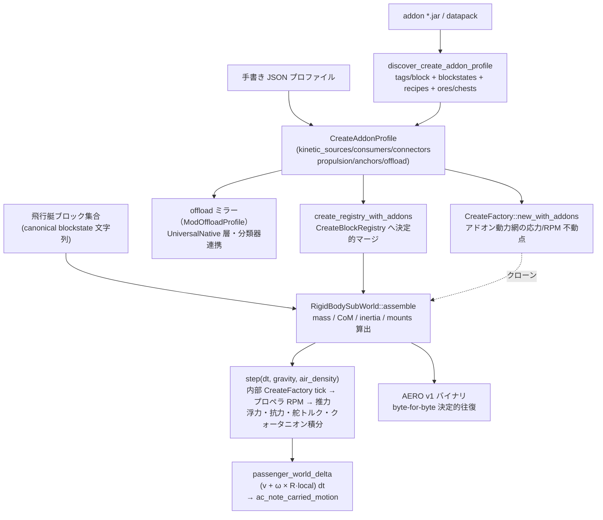

<!-- SPDX-License-Identifier: LGPL-3.0-or-later OR GPL-3.0-or-later OR AGPL-3.0-or-later -->

# Create: Aeronautics 6-DOF 剛体サブワールド ＋ 汎用 Create アドオン拡張

- **ステータス**: **実装済（`create-adapter/src/aeronautics.rs` / `addon_profile.rs`）**
- **関連設計**:
  - [汎用 Mod アダプタ ＋ 4 段階フォールバック](universal-mod-adapter.md)
  - [Create Mod 対応方針（別枠・特別最適化）](create-mod-strategy.md)
  - [S5 汎用オフロードカーネル仕様](s5-offload-kernels.md)

---

## 1. 目的

Create: Aeronautics（飛行艇）と、全 Create アドオン（Steam 'n' Rails / Crafts & Additions / New Age / Diesel Generators / Big Cannons / Clockwork 等）を **アドオン個別の Rust 実装なし** で扱う。Zero-JVM・決定論的・Save v2 名前空間レジリ安全の既存制約を維持し、未対応内容は従来通り 4 段階フォールバック分類器へ流す。

## 2. 構成図

## 3. 汎用 Create アドオン プロファイル（`addon_profile.rs`）

`CreateAddonProfile` は `mod_adapter_core::ModOffloadProfile` を Create 固有ルールで拡張する宣言的記述（JSON / プログラマティック両対応）:

| フィールド | 役割 | 例 |
|---|---|---|
| `kinetic_sources` | 動力源 `(base_rpm, stress_capacity, axis)` | `createaddition:electric_motor`, `create_new_age:energiser_t1`, `createaeronautics:propeller_engine` |
| `kinetic_consumers` | 応力消費 `(stress_impact, min_rpm)` | `createaddition:alternator`, `createaeronautics:propeller_bearing`, `torsion_spring` |
| `connectors` | 動力伝達 (`shaft`/`gearbox`/`belt`/`clutch`/`gearshift`/`encased`) | アドオンシャフト・チェーン伝達 |
| `propulsion` | `PropulsionSpec`: 推力 N/RPM・浮力 N/ブロック・高度逓減・抗力・舵トルク・角減衰 | Aeronautics 既定値 + ブロック集合 |
| `assembly_anchors` | 組立起点 | `airship_assembler`, `compass_table` |
| `transport` / `fluid_*` / `hidden` / `decorative` | 汎用層へそのままミラー | アドオンのベルト・タンク・鉱石 |

`finalize()` が Create 側全ブロックを `offload.blocks` へユニバーサル役割（NetworkGenerator / NetworkConsumer / NetworkCable / ContraptionAnchor / Decorative）でミラーし、`create_registry_with_addons` がベース `create:*` 定義とアドオン定義を **カノニカル ID ソート順** で 1 レジストリに統合するため、ロード順変更で状態 ID がずれない。

### 3.1 JAR / データパック自動発見（`discover_create_addon_profile`）

`mod-adapter-core` の Zero-JVM ローダが得た `LoadedModData` から：

1. `data/<ns>/tags/block/*.json`（および `tags/blocks/`）を走査し、タグ名ヒューリスティック（`propeller`, `balloon`/`envelope`, `shaft`, `motor`/`engine`, `bearing`→anchor 等）で分類。**分類可能なタグ名はアドオン作者の意図として優先**、無名タグはメンバー名ヒューリスティックへフォールバック。
2. blockstates 定義から未分類ブロックとプロパティ集合（`axis`, `facing`, `powered` …）を発見し、レジストリへ決定的に登録。
3. `data/c/tags/(block|blocks)/(ores|chests|barrels)` ルートはワールド保護のため `hidden_blocks` へ。
4. レシピ種別 (`<ns>:grinding` → `grinder` 等の語幹一致) で加工機を `processor_recipe_types` へ接続。

未知アドオンはこれにより Rust コードなしで Tier 0/1 相当に自動昇格し、分類不能な残部は従来の 4 段階フォールバックへ。

### 3.2 同梱リファレンスプロファイル

`createaeronautics` / `railways` / `createaddition` / `create_new_age` の 4 プロファイルを同梱し、合成「未知アドオン」JAR の発見テストとともに回帰固定。

## 4. 6-DOF 剛体サブワールド（`aeronautics.rs`）

`RigidBodySubWorld` は Create の 1 軸 Contraption を一般化した完全 6 自由度シミュレーション単位（Aeronautics / Simulated / Clockwork / Valkyrien Skies 類の飛行艇に対応）:

- **状態**: `id`, `parent_dim`（動的次元対応）, `pos`, 単位クォータニオン `quat [x,y,z,w]`, `vel`, `omega`, 疎ローカルボクセル `BTreeMap<[i32;3], String>`（**カノニカル blockstate 文字列のみ**保存 → Save v2 耐性）。
- **内部ファクトリ**: 組立・編集のたびに `CreateFactory` を `DimBlockPos(parent_dim, local)` へ再展開し、飛行中もプロペラ・シャフト・ベルト・歯車が実際に tick する。
- **物理量**: `mass`（ブロック数×単位質量）, `center_of_mass`, 対角慣性 `inertia_diag`, `buoyancy_blocks`, `propellers`（軸・min_rpm・N/RPM）, `rudders`（トルク軸・検出軸・ゲイン）を毎編集時に再計算。

### 4.1 決定論的固定ステップ積分（20 TPS）

`step(dt, gravity, air_density)` の順序:

1. 内部 `CreateFactory::tick` で動力網を 1 tick 進める。
2. 各 `PropellerMount` の実 RPM（`min_rpm` 未満は 0）→ ローカル推力ベクトル、`quat` でワールド回転。
3. 重力 `mass·g·(0,-1,0)` ＋ 高度逓減気球浮力 ＋ 2 次空気抗力 `c·ρ·|v|·v`。
4. 舵ウェザーコック（`gain·ρ` に比例）＋ 角減衰（ローカル系）→ ワールドトルク。
5. `vel`/`pos`/`omega` を半陰的積分、`quat` を `q̇ = ½ ωq` で更新し正規化。非有限値は全て `sanitize` で除去し、`vel`/`omega` は上限クランプ（NaN/Inf・発散を構造的に排除）。

### 4.2 座標変換と乗客追従

- `local_to_world(p) = pos + R·p`、`world_to_local(p) = Rᵀ·(p − pos)`（共役による厳密逆変換）。
- `passenger_world_delta(local_offset, dt) = (v + ω × (R·offset))·dt` — 有限差分一致を単体テストで固定。`mc-spine` の `ac_note_carried_motion` フックへ直接供給する設計で、飛行艇の操縦者・乗客がアンチチートでラバーバンドしない。

### 4.3 `AERO` v1 スナップショットコーデック

`encode_aeronautics_snapshot` / `decode_aeronautics_snapshot`: マジック `b"AERO"` + version `1`、スカラーはビッグエンディアン `f64`/`u64`/`u32`、列長は u32、ブロックは `[i32;3]`+MC 文字列。既存 `MSMO`/Save v2 と同じ「実行時 ID を保存しない・文字列カノニカル」原則に従い、レジストリ再順序・再ロードで byte-for-byte 決定往復する。ブロックだけを保存し質量・マウントは復号時に再計算しない（スナップショット値を信頼し検証する）ことで、編集中間状態も忠実に復元する。

## 5. 既存ブリッジとの接続

- `parent_dim`/`DimBlockPos` により動的カスタム次元でも内部動力網が正しい次元キーで動作。
- `passenger_world_delta` は `ac_note_carried_motion`（Contraption 乗客・ベルト乗客と同一経路）へ 1 tick 分の厳密移動量を供給する前提の API 形。
- 分類不能ブロック・未対応 Mixin を持つアドオンは従来の `strict`/`quarantine`/`delegate` 分類器へ落ち、サイレント無視はしない。
- 本機能は `mod-adapter-core`/`create-adapter`/`mod-offload`/`specs` のみで完結し、ルート `src/mod_offload_bridge.rs` への変更は不要。

## 6. 検証（`cargo test -p create-adapter`）

| 観点 | テスト |
|---|---|
| 組立・質量・CoM・慣性・マウント | `assembly_computes_mass_com_inertia_and_mounts` |
| 飛行中動力網 → 実推力・前進加速 | `live_kinetic_propeller_generates_real_thrust_and_forward_acceleration` |
| 浮力平衡 2,000 tick 無発散 | `buoyancy_equilibrium_holds_without_divergence_over_2000_ticks` |
| 6-DOF 変換往復・乗客 Δ 有限差分一致 | `rotation_transforms_roundtrip_and_passenger_delta_matches_finite_difference` |
| AERO v1 byte-for-byte 往復＋継続 tick | `aero_v1_snapshot_roundtrips_byte_for_byte_and_keeps_ticking` |
| 4 内蔵プロファイル統合 | `all_builtin_addons_compose_into_one_registry` |
| JSON プロファイル往復 | `json_profile_round_trips_create_specific_sections` |
| 未知アドオン JAR 自動発見 | `unknown_addon_jar_autodiscovers_kinetics_transport_and_hidden_blocks` |

ベンチ: `create-adapter/src/bin/aeronautics_bench.rs` — 100 隻の飛行中 6-DOF 飛行艇（各々内部に動力源→シャフト→プロペラベアリングの live kinetic network）を 20,000 tick 回し、ship-tick あたり ns と world-tick あたり µs を報告。
