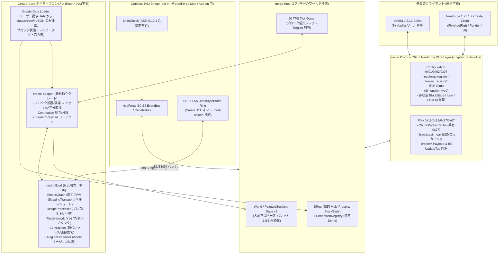

<!-- SPDX-License-Identifier: LGPL-3.0-or-later OR GPL-3.0-or-later OR AGPL-3.0-or-later -->

# Create Mod 対応方針・アーキテクチャ設計（Option 比較と確定方針）

- **対象版**: Minecraft Java 1.21.1（Protocol 767）/ NeoForge `21.1.172` / Create `6.0.x`（1.21.1 世代）
- **ステータス**: **方針確定（Phase C0 設計完了・実装ゲート定義済み）**
- **前提契約**:
  - [Mod互換shim計画（S0〜S5）](shim-plan.md)
  - [NeoForge 1.21.1 互換層アーキテクチャ設計](neoforge-architecture.md)
  - [S4 ネットワーク・ケイパビリティ・Fabric 設計](s4-network-capabilities-and-fabric.md)
  - [S5 汎用オフロードカーネル仕様](s5-offload-kernels.md)
- **実測根拠**:
  - [mod-offload ベンチマーク実測](s5-offload-kernels.md#reproduction)
  - [OFF5 / S5 JNI オフロード実測](../../evidence/mod-compatibility/create-offload-contract-20261120.md)
  - [1.21.1 Mod 表面積監査](../../evidence/mod-compatibility/top-mods-surface-20261120.md)
  - [HotSpot 21 vs Ristretto 評価](../../evidence/mod-compatibility/ristretto-eval-20261120.md)

---

## 1. 結論（確定方針）

**採用案: 案 C「Rust-First ネイティブ実行エンジン（`mod-offload` 本体統合）＋ 標準 NeoForge+Create クライアント互換プロトコル ＋ 薄型 JVM アドオン橋渡し」のハイブリッド構成**

Create 規模の超重量級 Mod に対して「無改造の Create 実 JAR を NeoForge shim 上でそのまま動かす（案 A）」方針は**不採用**とし、逆に「既存クライアントと互換性のない独自プロトコルへ分岐する（完全独自フォーク）」ことも**不採用**とする。

確定方針の核心は以下の 3 点である：

1. **サーバー側 Create コア演算は 100% Rust ネイティブ（`mod-offload` の 6 カーネル）で所有する**
   - ユーザー提供の Create JAR（およびアドオンの datapack）から **Java バイトコードを実行せずデータのみ（レシピ・タグ・ブロック状態スキーマ・ルートテーブル）を抽出・登録**し、回転網・ベルト輸送・機械加工・流体網・Contraption 衝突・リージョン隔離をすべて Rust で直接実行する。
   - **純 Rust 構成（JVM なし）でも Create サーバーが起動・稼働**し、GC 停止ゼロ・待機時 6 ns/tick・リージョン隔離の軽量性を最大化できる。
2. **接続クライアントは「無改造の標準 NeoForge 1.21.1 + Create クライアント」をそのまま受け入れる**
   - Configuration フェーズで NeoForge レジストリ同期（`neoforge:register` / `neoforge:frozen_registry*`）と多状態 `BlockState` テーブルを配信し、Play フェーズで Create のカスタムペイロード（`create:*`）および BlockEntity NBT 同期を Rust 側で終端する。
   - クライアント側の Flywheel インスタンシング描画・Ponder・Create UI は既存の Create クライアント側で無改造のまま動作する。
3. **一般 NeoForge Mod および Create アドオンは「薄型 JVM 橋渡し（S0〜S4 ＋ OFF5/S5）」で段階対応する**
   - 軽量〜中量 NeoForge サーバー Mod（保護・管理・独自ブロック/アイテム・イベント）は既存の [`compat/neoforge-events/`](../../compat/neoforge-events/README.md)（HotSpot 21 埋め込み + `ShimCheck` フェイルクローズ）を継続拡張する。
   - Create アドオン（追加レシピ・追加応力ブロック・簡易機械）はデータ駆動登録＋`OFF5`/`S5` DirectByteBuffer 橋渡し（実測 **0.080 µs 待機 / 6.67 µs per 2,000 ノードバッチ**）経由で Rust `mod-offload` エンジンへ直接接続する。

---

## 2. 3 案の定量的比較（NeoForge 互換層拡張 vs Rust ネイティブ統合 vs ハイブリッド）

| 評価軸 | 基準: 実 NeoForge 1.21.1 + Create 6.x | 案 A: NeoForge shim 全面拡張（無改造 Create JAR 実行） | 案 B: 純 Rust 完結（JVM 完全廃止） | **案 C（採用）: Rust-First コア ＋ 標準クライアント互換 ＋ 薄型 JVM 橋渡し** |
|---|---|---|---|---|
| **無改造 Create クライアント接続** | 可（基準） | 可 | プロトコル完全実装なら可 | **可**（NeoForge Registry Sync + `create:*` Payload を Rust で実装） |
| **サーバー側 Create JAR の Java 実行** | フル実行（Registrate + Mixin + AT） | 必須（数千の `net.minecraft.*` メソッド + MixinExtras `@WrapOperation`/`@Redirect` + AT の完全再現が必要） | なし（データ JSON のみ読込） | **Create コアは不要（データ JSON のみ読込）**。他 Mod 用に JVM は opt-in 保持 |
| **サーバー RSS 見積り** | 大（JVM + Vanilla + NeoForge + Create で概ね 1.2〜2.5+ GiB 級。*同条件実測は C5 で実施*） | 中〜大（JVM + Create クラス群 + 大規模 facade で +300〜800 MiB 増、軽量化幅が縮小） | 最小（純 Rust `megu` 380 MiB 基準 + Create 状態 ~10〜30 MiB。*実測は C5*） | **純 Create サーバーは最小（JVM なし起動可）**。他 NeoForge Mod 併用時でも +55.1 MiB 基準（[ristretto-eval](../../evidence/mod-compatibility/ristretto-eval-20261120.md)）から増分を抑制 |
| **大規模工場の tick 負荷** | Java `BlockEntity.tick()` 毎 tick 走査＋GC | Create Java tick がそのまま走るため、結局 JNI 往復地獄になり NeoForge より遅くなるリスク大 | **最速**（実測: 待機 10,000 機械 **6.00 ns/tick**、混合 5,500 連鎖 **396.66 µs/tick**、256 ブロック Contraption **11.50 µs/tick**） | **案 B と同等のネイティブ速度**（Create コア演算に JNI 境界を挟まない） |
| **他 NeoForge Mod / Create アドオン** | フル対応 | 表面積が広がれば対応 | 不可（Java Mod 非対応） | **S0〜S4 適合 Mod ＋ データ駆動/OFF5 アドオン対応**（未対応 Mixin/AT は起動時フェイルクローズ） |
| **実装・保守コスト（版追従）** | 上流依存 | **極大**（Create の内部 Mixin 変更ごとに `net.minecraft` バイトコード互換が崩壊） | 中（Create の全機能を段階実装） | **中・段階出荷可能**（C1〜C5 でコア機械から順に実用化、Mixin 地獄を回避） |
| **クリーンルーム / ライセンス安全性** | — | Mojang マッピング・バイトコード依存が肥大化 | 高（LGPL/GPL/AGPL 独自 Rust + ユーザー提供データ読込） | **高**（Create コア演算はクリーンルーム Rust、ユーザー提供 JAR からデータ抽出のみ） |

### なぜ案 A（無改造 Create JAR を NeoForge shim 上で動かす）を棄却するのか

1. **Mixin / AccessTransformer の壁**:
   - Create 1.21.1 は `create.mixins.json` と `META-INF/accesstransformer.cfg` で `Level` / `ServerLevel` / `ChunkMap` / `Entity` / `LivingEntity` / `AbstractMinecart` / `FluidState` / `StructureTemplate` 等のメソッド本体内部へ `@Inject(at = @At("INVOKE"))`・`@Redirect`・`@ModifyVariable`・MixinExtras `@WrapOperation` を注入する。
   - `megu` は「Vanilla クラスを読み込まず Rust が唯一のワールド権威を持つ」設計（[neoforge-architecture.md §2](neoforge-architecture.md)）であり、Vanilla メソッドの正確なバイトコード命令列が存在しないため、メソッド本体内部への Mixin 注入は構造的に成立しない。
2. **API 表面積の爆発**:
   - Create は Registrate を介して約 700+ ブロック・500+ アイテム・100+ BlockEntity・約 60+ カスタムネットワークパケット・独自 `RecipeType` / `DataComponent` / `FluidHandler` / `Menu` を登録し、`net.minecraft.*` 全体で数千メンバーを参照する。これを手書きファサードで追従するのは保守不能である。
3. **本末転倒な性能劣化**:
   - 仮にファサードを構築しても、Create 側の Java `BlockEntity.tick()` が毎 tick 各機械・ベルト・パイプから `level.getBlockState()` / `getBlockEntity()` / `setBlock()` を呼べば、1 tick あたり数万回の JNI 往復が発生し、**「NeoForge より大幅に軽量化する」という第一目的を自ら破壊する**。

---

## 3. 現状資産と技術ギャップの正確な棚卸し

すでに `megu` に実装・検証済みの土台と、Create 稼働までに埋めるべき 6 つの具体的ギャップを整理する。

### 3.1 既存資産（実測・テスト済み）

| コンポーネント | 場所 | 検証済み事実 |
|---|---|---|
| 6 種ネイティブシミュレーションカーネル | [`mod-offload/src/`](../../mod-offload/src/lib.rs) (`kinetic_graph`, `sleeping_transport`, `contraption`, `fluid_network`, `recipe_processor`, `region_scheduler`) | 依存ゼロ純 Rust + C11 ABI (`mso_*`)。待機 **6.00 ns/tick**（フルスキャン比 453×）、混合 5,500 連鎖 **396.66 µs/tick**、256 ブロック Contraption **11.50 µs/tick**、5 リージョン並列バックプレッシャ隔離確認済み。 |
| OFF5 / S5 バッチ JNI 境界 | [`tools/offload_ffi_probe/`](../../tools/offload_ffi_probe/run_probe.py) | 2,000 ノードバッチ JNI **6.672 µs**（1 件毎 JNI 102.3 µs 比 15.3×、ワイヤサイズ **4.00×** 削減）、Contraption 姿勢+パレット差分 **0.211 µs**（ワイヤサイズ **9.66×** 削減）、待機 JNI **0.080 µs**。 |
| NeoForge S0〜S4 互換土台 | [`compat/neoforge-events/`](../../compat/neoforge-events/README.md), [`src/java_compat.rs`](../../src/java_compat.rs) | `ShimCheck`（ASM 9.10.1）、`DeferredRegister`（単一状態カスタムブロック/アイテム）、S3 `DirectBatchBridge`、S4 `PayloadRegistrar`・`Capabilities.ItemHandler`、`build_config_registry_sync_packets`（`0x07` ビルダー）。 |
| サーバー高速化・次元基盤 | [`src/connection_limits.rs`](../../src/connection_limits.rs), [`src/play_protocol.rs`](../../src/play_protocol.rs), [`src/worldgen.rs`](../../src/worldgen.rs) | `ChunkPacketCache`（512 エントリ共有フレーム + 遅延圧縮）、`broadcast_near` 距離/次元カリング、動的 `DimId` / `DimensionRegistry`（Track 2 並行実装中）。 |

### 3.2 残存ギャップ（6 項目 — Phase C1〜C5 で順次解消）

| # | ギャップ | 現状 | Create 対応に必要な拡張 |
|---|---|---|---|
| **G1** | **多状態（Multi-Property）`BlockState` 登録** | 現行 S2 はカスタムブロック 1 個につき 1 状態（ID 26,684 以降）。 | Create ブロックは `axis`, `facing`, `waterlogged`, `part`, `shape`, `powered` 等のデカルト積（例: ベルト・歯車・シャフト・パイプ）を持つ。`BReg` の動的ブロック登録を **ブロック単位 + Property 組合せ展開（複数 State ID）** へ拡張し、NeoForge の `BlockState` 展開順（定義順の直積）と 100% 一致させる必要がある。 |
| **G2** | **NeoForge Configuration ネットワークハンドシェイクの本番配線** | `build_config_registry_sync_packets` と S4 設計書（[s4-network-capabilities-and-fabric.md](s4-network-capabilities-and-fabric.md)）はあるが、`src/play_protocol.rs` の Configuration ループ未配線。 | `neoforge:register` / `neoforge:network` / `neoforge:frozen_registry_sync_start` / `neoforge:frozen_registry` / `neoforge:frozen_registry_sync_completed` を `0x01`/`0x02` Configuration Custom Payload 上で処理し、無改造 NeoForge クライアント（Create 導入済み）を Vanilla クライアントと共存させつつ受け入れる。 |
| **G3** | **`mod-offload` のサーバー本体 tick ループ直接統合** | `mod-offload` は独立クレートであり、`src/main.rs` の 20 TPS tick ループ・ブロック設置/破壊・インベントリ・セーブと未接続。 | `megu` から `mod-offload` を Rust path 依存（`#[cfg(feature = "create-offload")]` またはワークスペース依存）で直接呼び出し、ブロック設置/破壊時に `KineticGraph`/`FluidNetwork`/`Transport` トポロジを差分更新し、毎 tick `RegionScheduler::step()` の出力 delta を直接ワールド・パケット送信へ適用する。 |
| **G4** | **流体ケイパビリティ (`IFluidHandler`) と流体レジストリ** | 現行 S4 は `Capabilities.ItemHandler.BLOCK` のみ。流体は Vanilla の水/溶岩のみ。 | Create の流体パイプ・ポンプ・タンク・スパウト向けに、名前空間付き流体 ID レジストリ（`minecraft:water`, `minecraft:lava`, `create:chocolate`, `create:honey`, `create:tea` 等）と mB 単位のタンク永続化・S4 `FluidHandler` 契約を追加する。 |
| **G5** | **Create Play ペイロード & BlockEntity 同期プロトコル** | 未実装。 | 無改造 Create クライアントが回転アニメーション・ベルト上アイテム・タンク液面・Contraption 移動を正しく描画するため、`0x07` BlockEntity Data (`updateTag`) と `create:*` Play Custom Payload（レンチ回転・フィルタ設定・Contraption エンティティ同期・速度設定等）のコーデックを実装する。 |
| **G6** | **Contraption のチャンク分解/再組立 & Save v2 永続化** | `mod-offload/src/contraption.rs` は疎パレット・姿勢・衝突・乗客デルタを実装済みだが、ワールドブロックとの組立/設置変換・セーブ永続化が未接続。 | 回転軸/ピストン/ガントリー起動時の連結ブロック収集（スーパーグルー/シャーシ規則）→ ワールドから除去＆`Contraption` 生成 → 停止時のグリッドスナップ再配置（CAS + `set_block_if_dim`）→ Save v2 への Contraption 状態・機械状態の名前ベース保存を実装する。 |

---

## 4. 確定アーキテクチャ（データフローと層境界）

### `layers_check.sh` とモジュール隔離の不変条件

既存の 44 モジュール層契約（[`evidence/foundation/module-layers/policy.json`](../../evidence/foundation/module-layers/policy.json)）および「純 Vanilla ビルド時のオーバーヘッドゼロ」契約を厳守するため：

1. **Create 固有ロジックは独立クレート `create-adapter/` として分離**し、`mod-offload/` に依存する（`megu` 本体はオプショナル feature `create-offload` 経由でのみ `create-adapter` を参照する）。
2. **`mod-offload/` 自体は引き続き Create 非依存の汎用カーネル**（AE2・Mekanism にも転用可能）に保ち、Create 固有のブロック名・応力係数・レシピ種別はすべて `create-adapter/` に閉じ込める。
3. **純 Rust デフォルトビルド（`--no-default-features`）では `java-compat` も `create-offload` も完全にコンパイル除外**され、Vanilla ワールド生成・`layers_check.sh`・`debt_ratchet.sh`・`provenance_check.py` に一切影響しない。
4. **動的ディメンション（Track 2）との整合**: `mod-offload` の `RegionKey { dimension: i32, x: i32, z: i32 }` は既に任意 `i32` 次元 ID を受け取る設計であるため、Track 2 の動的 `DimId(u32)`（Overworld=0, Nether=1, End=2, Custom>=3）とそのまま 1 対 1 で結合でき、**カスタム次元内に建てた Create 工場もリージョン隔離付きでそのまま動作する**。

---

## 5. `mod-offload` 6 カーネルと Create サブシステムの 1 対 1 マッピング

| Create サブシステム | 対応カーネル | サーバー側ネイティブ挙動 | クライアント同期（無改造 Create クライアント向け） |
|---|---|---|---|
| **回転動力網**（Shaft, Cogwheel, Large Cogwheel, Gearbox, Clutch, Gearshift, Water Wheel, Windmill, Steam Engine, Rotation Speed Controller, Stressometer） | `kinetic_graph.rs` | 隣接軸/歯車接続を無向グラフ＋符号付き速度比（`±1.0`, `±2.0`, `±0.5` 等）で表現。ブロック設置/破壊/クラッチ切替時のみ連結成分を再計算。過負荷時は `MSO_KINETIC_OVERSTRESSED` で全ノード停止。**定常時は 0 ノード走査（6 ns/tick）**。 | 連結成分の速度・応力変化時のみ、該当チャンクの追跡プレイヤー（`broadcast_near`）へ BlockEntity UpdateTag（`Speed`, `Network`, `Capacity`, `Stress`）を差分送信。 |
| **アイテム輸送**（Mechanical Belt, Depot, Chute, Smart Chute, Funnel, Brass Funnel） | `sleeping_transport.rs` | ベルト各セグメント/シュートを FIFO＋RPM 反比例遅延のタイマーノードとして登録。入力空または出力満杯で即スリープし、投入・抽出・RPM 変化時のみ起床。 | `MSO_S5_TRANSPORT_TRANSFER` イベント時のみ、ベルト上アイテム配列の増分 NBT / パケットを近傍プレイヤーへ配信。毎 tick の全ベルト再送を廃止。 |
| **機械加工**（Mechanical Press, Mixer + Basin, Saw, Millstone, Crushing Wheels, Encased Fan, Deployer） | `recipe_processor.rs` | JAR の `data/create/recipe/*.json` をデータ駆動ロード。`base_ticks` を RPM スケール（16 RPM 基準、過負荷/RPM=0 で一時停止）で完了期限を 1 イベント予約。 | 加工開始・完了（`MSO_S5_RECIPE_EVENT`）時のみ進行状態 NBT と出力アイテム/パーティクルを同期。 |
| **流体網**（Fluid Pipe, Mechanical Pump, Fluid Tank, Spout, Item Drain） | `fluid_network.rs` | タンク高度・容量・ポンプ符号付き揚程による静的圧力平衡を整数体積保存で解く。単一流体種制約＋閉路非ゼロ揚程の原子的拒否。定常時は作業キュー空。 | `MSO_S5_FLUID_TANK_UPDATE` 変化分のみタンク液量 NBT を同期。 |
| **移動複合構造**（Mechanical Bearing, Mechanical Piston, Gantry Carriage, Rope Pulley, Minecart Contraption） | `contraption.rs` | 組立時にローカル疎パレット＋ブロック状態 ID を構築。毎 tick は単一剛体姿勢（位置・yaw/pitch・速度）更新と統合 AABB 広域判定＋有向ボックス狭域判定＋乗客剛体移動デルタを **11.5 µs / 256 ブロック** で計算。 | 初回のみシード形状を送信し、稼働中は `0x0101` 姿勢（56 B）と変化セルのみの `0x0102` 差分（17 B/セル）を配信（全再送比 **9.66×** 削減）。 |
| **マルチ工場の負荷隔離** | `region_scheduler.rs` | `(DimId, region_x, region_z)`（32×32 ブロック区画）ごとに独立スケジュール＋処理件数クォータ＋ソフト µs 予算。 | 特定リージョンの巨大工場が予算超過してもバックログ繰り越しに留め、他リージョン・他プレイヤー・Vanilla tick（20 TPS）を巻き添えにしない。 |

---

## 6. 段階的実装ロードマップ（Phase C0〜C5）と合格ゲート

| Phase | スコープ | 主な成果物 | 合格ゲート（Exit Criteria） |
|---|---|---|---|
| **C0（完了）** | 方針確定・アーキテクチャ設計 | 本設計書（`specs/mod-compatibility/create-mod-strategy.md`） | 案 A/B/C の定量的比較、6 ギャップ特定、`layers_check` 隔離方針、C1〜C5 ゲート確定。 |
| **C1: 多状態 `BReg` ＋ NeoForge Registry Sync 配線** | ギャップ G1・G2 | ① `BReg` 動的 Multi-Property `BlockState` 登録（デカルト積展開＋名前ベース Save v2 パレット永続化） ② `src/play_protocol.rs` に NeoForge Configuration ハンドシェイク（`neoforge:register` / `neoforge:frozen_registry*`）実装（Vanilla クライアント非干渉） ③ Create JAR データ抽出ツール（`data/create/` レシピ・タグ・ブロック定義読込、Java 非実行） | ① Vanilla 1.21.1 クライアントの既存全テスト 100% PASS ② 合成 NeoForge クライアント（wire テスト）が `neoforge:frozen_registry` を通過して多状態カスタムブロックを設置・再起動保持できること ③ 実 Create 1.21.1 JAR のデータ抽出がゼロエラーで完了すること |
| **C2: `create-adapter` 創設 ＋ 回転動力網（Kinetics）本番接続** | ギャップ G3・G5（第 1 弾） | `create-adapter/` クレート新設。`mod-offload::KineticGraph`＋`RegionScheduler` を `src/main.rs` 20 TPS tick ループへ接続。Shaft / Cogwheel / Gearbox / Clutch / Water Wheel / Stressometer の設置・接続・応力計算・過負荷停止・BlockEntity 同期・Save v2 保存。 | ① 無改造 NeoForge 1.21.1 + Create クライアントから接続し、水車→歯車→シャフトの回転描画・応力計表示・過負荷停止・再起動復元が動作すること ② 10,000 静止回転ノード配置時の tick 追加負荷 ≤ 0.1 ms |
| **C3: ベルト輸送 ＋ 機械加工 ＋ 流体網** | ギャップ G4・G5（第 2 弾） | `SleepingTransport`（Belt / Funnel / Chute / Depot）、`RecipeProcessor`（Press / Mixer / Basin / Millstone / Saw / Fan）、`FluidNetwork`（Pipe / Pump / Tank / Spout / Drain）＋流体レジストリ＆タンク永続化。 | ① 自動化ライン（原木→製材→ベルト→プレス→チェスト、流体ポンプ→タンク→スパウト）が無改造 Create クライアントで動作し、再起動後もアイテム・液量・加工状態が保存されること ② 500 稼働ライン + 5,000 待機ライン同時配置でサーバー MSPT p95 < 5 ms |
| **C4: Contraption ＋ Optional JVM Add-on Bridge (`OFF5`)** | ギャップ G6 + アドオン連携 | 回転ベアリング / ピストン / ガントリーの組立・衝突・乗客輸送・再配置＋Save v2 保存。S0〜S4 NeoForge 互換層へ `OFF5`/`S5` アドオン橋渡し口（追加応力・追加レシピ・カスタム機械）を接続。 | ① 256 ブロック回転 Contraption 上にプレイヤーが乗って落下せず移動でき、停止後にブロックが元の位置へ完全復元されること ② 合成 Create アドオン JAR が `ShimCheck` 通過＋`OFF5` 経由でカスタムレシピ/応力を登録できること |
| **C5: 実 NeoForge 1.21.1 + Create 6.x 直接比較ベンチマーク** | 性能実証ゲート | 同一シード・同一巨大工場ワールド・同一クライアント数（0人 / 1人 / 8人）での **実 NeoForge 1.21.1 (+ Lithium/FerriteCore 有無) + Create 6.x** vs **`megu` (`--features create-offload`)** 再現可能ベンチマーク（`tools/create_load_compare.sh`）と証拠文書化。 | 実測レポートに以下をすべて記録（捏造・推測なし）： - `VmRSS` / `VmHWM`（定常・負荷後） - サーバー MSPT `p50 / p95 / p99` - スレッド数・CPU 時間 - クライアントあたり下り帯域（KB/s） - 目標: **RSS 1/3 以下、大規模工場 MSPT p95 1/5 以下** |

---

## 7. 未対応領域の明示（フェイルクローズ契約）

誇張や曖昧さを避けるため、確定方針でも**意図的にスコープ外（または起動時明示拒否）**とする領域を以下に固定する：

1. **任意の Mixin（`@Redirect`, `@ModifyVariable`, `@WrapOperation`, `@Inject(at = @At("INVOKE"))`）や AccessTransformer を使う Java Mod**:
   - `ShimCheck`（ASM 9.10.1）が TCP リスナ開始前に具体的な理由コード付きで起動拒否する。
2. **Create 6.x の全サブシステム一括完成（初回リリース時点）**:
   - **列車網（Trains / Track Graph / Schedule）・小包物流（Stock Ticker / Chain Conveyor / Frogport）・Schematicannon** は Phase C4 完了後の **Phase C6（後期拡張）** として切り出し、まず C1〜C4（動力・ベルト・加工・流体・基本 Contraption）を高い完成度と実測軽量性で仕上げる。
3. **クライアント側描画（Flywheel / Ponder）の `client-app` 内再実装**:
   - 当面は **無改造 NeoForge + Create クライアント** を正規クライアントとし、独自 `client-app` での Create ブロック/Contraption 描画は `client-app` の GPU バックエンド整備後に別トラックで検討する。

---

## 8. 次アクション（Phase C1 着手条件）

現在並行実行中の以下 2 トラックが `main` へ統合され次第、**Phase C1** へ直結できる：

1. **Track 2（動的ディメンション `DimId` / `DimensionRegistry`）**: 任意次元の `0x07` Registry Data 動的追加と Save v2 名前ベース永続化パターンが確立され、そのまま C1 の多状態カスタムブロック永続化・`RegionKey(dim, rx, rz)` へ接続できる。
2. **Track 1（Wave B: グラフオクルージョンカリング S1–S5 + 粗 LOD + Spec/Gate）**: サーバー/クライアント双方のベースライン性能計測が最新化され、C5 比較ベンチマークの基準線が確定する。
