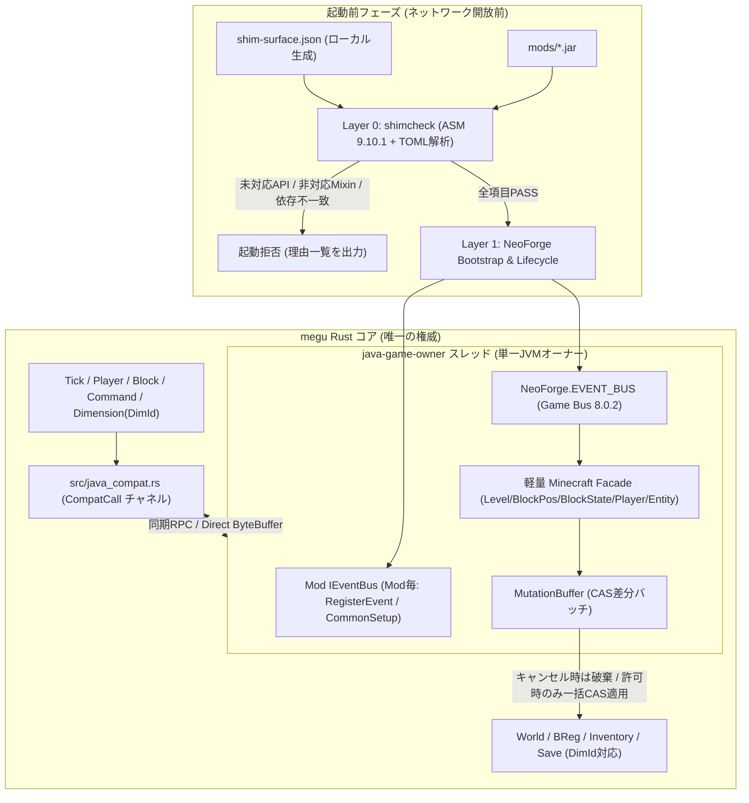
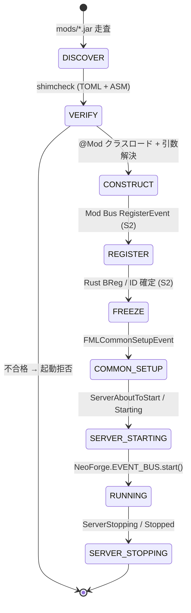

# megu NeoForge 1.21.1 互換層 アーキテクチャ設計（S0〜S3+）

- **対象版**: Minecraft Java 1.21.1（protocol 767）/ Java 21 / NeoForge `21.1.172`・FML `4.0.39`・EventBus `8.0.2`・ASM `9.10.1`
- **上位契約**: [mod-compatibility README](README.md) / [shim計画（S0〜S5）](shim-plan.md) / [Slice 03 NeoForge](slices/03-neoforge.md)
- **既存実装の土台**: [`src/java_compat.rs`](../../src/java_compat.rs)（単一 JVM オーナー＋JNI）、[`src/landing.rs`](../../src/landing.rs)（`DimId` 対応済み）、[`compat/neoforge-events/README.md`](../../compat/neoforge-events/README.md)

---

## 1. 現状の到達点と限界

| 要素 | 現状（`perf/worldgen-parallel`） | 課題（一般 NeoForge Mod へのギャップ） |
|---|---|---|
| Mod 検出 | [`Bootstrap.java`](../../compat/neoforge-events/java/net/megu/neoforge/Bootstrap.java) で Seed Protect の SHA-256 をハードコード | `neoforge.mods.toml` の解析・依存関係検証・複数 Mod ロード・`@EventBusSubscriber` が未実装 |
| イベント配送 | `FarmlandTrampleEvent` 1 種のみ（[`ServerHooks.java`](../../compat/neoforge-events/java/net/megu/neoforge/ServerHooks.java)） | 参加・チャット・破壊/設置・コマンド・tick・Mod Bus ライフサイクルが未配線 |
| World ABI | 単発 `Trample` 専用（`DimId` 伝播は完了済み、[`src/java_compat.rs`](../../src/java_compat.rs)） | Entity/BlockState が opaque、1 セル毎の JNI 往復を避ける汎用 `MutationBatch` ABI が未配線 |
| 静的拒否 | 未実装 | 未対応 `net.minecraft.*` メンバーや `@Redirect` Mixin を起動前に明示拒否できない |

---

## 2. 設計原則（megu 固有の不変条件）

1. **Single Authority in Rust**: ワールド状態・チャンク（`PalettedSection`）・tick・在庫・セーブ・ネットワークは 100% Rust 所有。Java 側は「世代付きハンドル＋ファサード＋変更バッファ」のみを持ち、第二のワールド状態を作らない。
2. **Fail-Closed Startup (`shimcheck`)**: 起動前に全 Mod JAR を ASM で静的検査し、未対応のクラス/メソッド/フィールド・未対応 `@Mixin` 注入種別・未対応 AccessTransformer・依存バージョン不一致を **TCP リスナ開始前に具体的な理由付きで拒否**する。
3. **Lock-Free Crossing & Batched JNI**: Rust の `WORLD` ミューテックス等を保持したまま JNI を絶対に呼ばない。イベント 1 発につき値渡しの `EventEnvelope` と戻り `MutationBatch` で O(1) 往復に抑える。
4. **Zero Overhead When Disabled**: `--no-default-features`（純 Rust ビルド）時は互換層コードを完全除外し、[`tools/layers_check.sh`](../../tools/layers_check.sh) の層境界を維持する。
5. **Mojang 由来生成物の非同梱**: `net.minecraft.*` の shim 骨組みはユーザー自身の 1.21.1 jar＋公式マッピングから手元生成し、リポジトリに Mojang 由来バイトコード・マッピングを同梱しない。

---

## 3. 全体アーキテクチャ（5 レイヤ構成）

---

## 4. 各レイヤの詳細設計

### Layer 0: `shimcheck` と Mod Discovery（S0 / NF-0）

既存の [`compat/neoforge-events/dependencies.json`](../../compat/neoforge-events/dependencies.json) にピン留め済みの **ASM `9.10.1`** をそのまま活用し、ランタイム起動前チェッカとスタンドアロン CLI の双方から呼べる構成にする。

- **メタデータ解析 (`META-INF/neoforge.mods.toml`)**:
  - `modLoader = "javafml"`, `loaderVersion`, `[[mods]]`（`modId`, `version`, `displayName`）, `[[dependencies.<modId>]]`（`neoforge`, `minecraft`, 他 Mod の Maven バージョン範囲）を厳密検証。
  - `[[mixins]]` エントリと `[[accessTransformers]]` エントリを列挙。
  - 循環依存・必須依存欠落・`modId` 重複・`clientSideOnly = true` 以外の未対応ローダを即拒否。
- **ASM バイトコード静的監査**:
  - JAR 内全 `.class` の `MethodInsnNode` / `FieldInsnNode` / `TypeInsnNode` / `SuperName` / `Interfaces` を走査し、`net/minecraft/*` と `net/neoforged/*` への参照を `(owner, name, descriptor)` 単位で収集。
  - `@OnlyIn(Dist.CLIENT)` / `Dist.CLIENT` 専属クラスはサーバー側ロード対象から除外しつつ、サーバー経路から到達していれば拒否。
  - `@Mixin` JSON が存在する場合、対象クラスと各 `@Inject`/`@Redirect`/`@ModifyVariable`/`@Overwrite` を分類し、サポート外の注入種別（S1 段階では `HEAD`/`RETURN`/`TAIL` 以外）を明示拒否。
- **出力**:
  - 人間可読なレポート＋機械判定用 JSON（対応率、未対応シンボル一覧、未対応 Mixin 一覧、拒否理由コード）。

### Layer 1: ライフサイクルと Dual Event Bus（S1 / NF-1）

実 NeoForge `21.1.172` + EventBus `8.0.2` をそのまま使い、自作イベントエンジンは作らない。

- **コンストラクタ引数解決（NeoForge 1.21.1 規約）**: `@Mod("...")` クラスのコンストラクタが受け取る `IEventBus`（Mod 専用バス）, `ModContainer`, `Dist`（`Dist.DEDICATED_SERVER`）を型照合で注入。
- **`@EventBusSubscriber` 自動登録**: `bus = Bus.GAME | Bus.MOD` および `value = {Dist.DEDICATED_SERVER}` を尊重し、クラスロード前に ASM アノテーション情報でフィルタ（クライアント専用クラスのロード自体を回避）。

### Layer 2: Rust↔Java ハンドル＆バッチ JNI ABI（S1〜S3 / NF-1〜NF-2）

現在の [`src/java_compat.rs`](../../src/java_compat.rs) の単発 `Trample` チャネルを汎用化し、以下の契約に統一する。

1. **次元対応・世代付きハンドル**:
   - `LevelHandle`: `dim: u8`（`0 = Overworld, 1 = Nether, 2 = End`）を必ず保持。
   - `BlockState`: Rust `BReg` の protocol 767 状態 ID (`u32`) をそのまま持つ軽量 flyweight（Java 側で全 26,684 状態オブジェクトを事前生成しない）。
   - `EntityHandle`: `(dim: u8, kind: u16, eid: i32, generation: u32)`。解放済み Entity へのアクセスは `IllegalStateException` でフェイルクローズ。
2. **S1 初期イベント面（実運用で需要が高く、Rust 側に既に所有者が存在する 6 種）**:
   - `BlockEvent.FarmlandTrampleEvent`（既存・`DimId` 対応済み）
   - `BlockEvent.BreakEvent`（キャンセル可・XP ドロップ値変更可）
   - `BlockEvent.EntityPlaceEvent`（キャンセル可）
   - `PlayerEvent.PlayerLoggedInEvent` / `PlayerEvent.PlayerLoggedOutEvent`
   - `ServerChatEvent`（キャンセル可・メッセージ差し替え可）
   - `RegisterCommandsEvent`（既存 [`src/brigadier.rs`](../../src/brigadier.rs) へコマンドノードを橋渡し）
3. **バッチ適用と再入制御**:
   - イベント呼び出しは Rust のロック解放状態で `CompatCall` を `java-game-owner` へ送信。
   - コールバック中の変更要求は Java 側 `MutationBuffer`（`SetBlockIf(dim, x, y, z, new_state, expected_state)`, `SendSystemMessage(player_eid, json)`, `SetCancel(bool)` 等）に蓄積し、1 回の返却で Rust 側へ戻して一括 CAS コミット。
   - コールバック内で別イベントを再帰発火した場合は `reentrancy_depth <= 4` で制限し、超過時はロールバック＋フェイルクローズ。

### Layer 3: レジストリ・パレット・永続化拡張（S2 / NF-3）

- **動的レジストリ領域**:
  - `DeferredRegister.create(Registries.BLOCK / ITEM, modid)` が `RegisterEvent` で提出したエントリを `FREEZE` フェーズで `(namespace, path)` 昇順に決定ソートし、Rust `BReg` の vanilla 末尾 ID 以降へ割り当て。
- **名前ベース永続化**:
  - チャンク／オーバーレイ保存時に、Mod ブロックは数値 ID ではなく名前空間付きパレット（`"modid:block[prop=val]"`）で永続化し、Mod の追加・順序変更でも既存ワールドが壊れないようにする。
- **プロトコル 767 同期**:
  - 接続クライアントの Configuration フェーズで、NeoForge クライアント向けのレジストリ同期ペイロードと整合する ID テーブルを配信（実 NeoForge 1.21.1 サーバーとの読み込み・保存一致が S2 合格条件）。

### Layer 4: バッチ JNI と重量 Mod オフロード接続点（S3〜S5 / NF-4+）

- **Direct `ByteBuffer` セクション境界（S3）**:
  - BlockEntity tick やコンテナ輸送で 1 セル毎の JNI 呼び出しを行わない。`ByteBuffer.allocateDirect` の固定リングバッファ越しに「更新されたチャンク/セクション差分とアクティブ BlockEntity リスト」をバッチ受け渡しする。
- **重量 Mod 向け 5 つの汎用カーネル接続点（S5）**:
  - [shim計画（S0〜S5）](shim-plan.md#将来拡張汎用オフロードカーネル重量-mod-向けネイティブ加速s3-以降) に沿い、Rust コア（`PalettedSection`・`EntitySpatialGrid`・`tick_queue`）上にデータ駆動コンテンツ／接続グラフ／スリープ型輸送／Contraption 移動塊／リージョン負荷隔離のフックを段階接続する。

---

## 5. Rust モジュール配置と `layers_check.sh` 境界

純 Rust コアを汚染しないため、互換層は以下の箇所に厳密隔離する：

| モジュール / ディレクトリ | 責務 | 依存方向 |
|---|---|---|
| `src/landing_types.rs` / 将来 `src/compat_types.rs`（下位層） | `dim: u8` 付きの `Trample` / `CompatEvent` / `CompatOutcome` / `MutationOp`（`jni` 非依存の純データ型） | 外部層へ新規エッジを追加しない |
| `src/java_compat.rs`（既存・最上位アダプタ） | `#[cfg(feature = "java-compat")]` 限定。JVM 起動・`shimcheck` 呼び出し・JNI マーシャリング・`MutationBuffer` 返却 | `landing_types` + `jni` |
| `compat/neoforge-events/`（拡張） | `ShimCheck.java`（ASM 9.10.1 + TOML 解析）、`Bootstrap.java`（動的ロード＋Dual Bus）、`ServerHooks.java`（S1 イベント群）、`net/minecraft/*` 軽量ファサード | 上流 NeoForge/FML/Bus/ASM JAR |
| `tools/shimcheck.py`（新規） | `compat/neoforge-events` の `ShimCheck` を呼び出し、任意 Mod JAR の互換性レポートを出力する CLI ゲート | Java 21 + ASM JAR |

---

## 6. 段階的実装ロードマップ（NF-0〜NF-4）

| ステップ | 内容 | 合格基準 |
|---|---|---|
| **NF-0 (S0)** | `ShimCheck.java` + `tools/shimcheck.py`（TOML + ASM 静的監査） | Seed Protect（NeoForge）で 100% 適合判定。未対応 Mod（例: 未対応 Mixin / 未知 `net.minecraft` メンバー）で具体的な拒否理由一覧と JSON レポートを出力 |
| **NF-1 (S1 基盤)** | `CompatEvent` 汎用化＋`Bootstrap.java` の SHA-256 ハードコード撤廃（`shimcheck` 通過＋`@Mod` / `@EventBusSubscriber(DEDICATED_SERVER)` 動的登録） | 既存 Seed Protect 全テスト PASS ＋ 2 つ目の単純イベント Mod が無改造 JAR で動作、RSS 増加 ≤ +60 MiB / 起動増加 ≤ +250 ms |
| **NF-2 (S1 拡張)** | `BreakEvent` / `EntityPlaceEvent` / `PlayerLoggedInEvent` / `ServerChatEvent` / `RegisterCommandsEvent`（Brigadier 連携）＋ `MutationBuffer` 一括適用 | 各イベントのキャンセル・書き換え・永続化・再入上限超過フェイルクローズを実 wire テストで確認 |
| **NF-3 (S2)** | `DeferredRegister` + `BReg` 動的拡張 + 名前ベース永続化 + 実 NeoForge 1.21.1 セーブ互換照合 | カスタムブロック設置 → 再起動保持 → 実 NeoForge 1.21.1 での読み込み一致 |
| **NF-4 (S3)** | BlockEntity / コンテナ / `scheduleTick` ＋ Direct `ByteBuffer` バッチ JNI | 1 セル毎 JNI 禁止のストレステスト合格・再入/ハンドル寿命テスト合格 |
