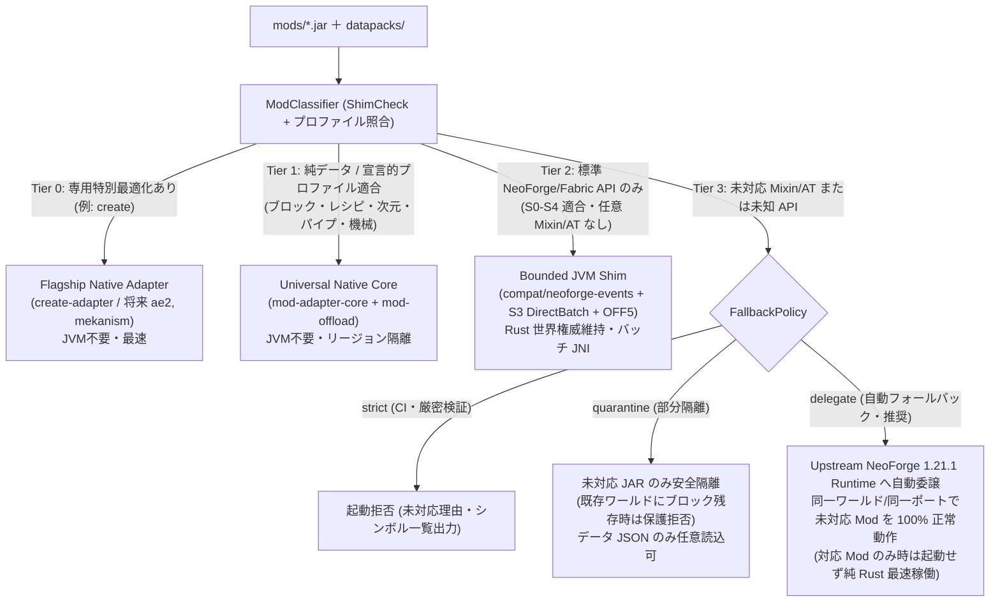

<!-- SPDX-License-Identifier: LGPL-3.0-or-later OR GPL-3.0-or-later OR AGPL-3.0-or-later -->

# 汎用 Mod アダプタ ＋ 全 Mod 向け最適化 ＋ フォールバック設計

- **ステータス**: **方針確定・`mod-adapter-core/` 実装着手**
- **関連設計**:
  - [Create Mod 対応方針（別枠・特別最適化）](create-mod-strategy.md)
  - [S5 汎用オフロードカーネル仕様](s5-offload-kernels.md)
  - [NeoForge 1.21.1 互換層アーキテクチャ設計](neoforge-architecture.md)
  - [S4 ネットワーク・ケイパビリティ・Fabric 設計](s4-network-capabilities-and-fabric.md)

---

## 1. 全体構成（2 層アーキテクチャ ＋ 4 段階実行・フォールバック階層）

全 Mod 向けの汎用最適化基盤と、Create のような超重量級 Mod 専用の特別最適化を明確に分離しつつ、未対応 Mod に対しても **サイレント破損を起こさずに正常動作へ導くフォールバック階層** を提供する。

---

## 2. 2 層分離の責務境界

### 層 1: 全 Mod 共通基盤（[`mod-adapter-core/`](../../mod-adapter-core/Cargo.toml) ＋ [`mod-offload/`](../../mod-offload/Cargo.toml)）

Create 固有の知識を一切持たず、任意の `namespace:path` の Mod へ汎用的に適用される共通エンジン：

1. **汎用 Multi-Property `BlockState` 展開 & Save v2 名前空間パレット**（`mod-adapter-core/src/blockstates.rs`）
   - 任意 Mod のブロック定義を NeoForge 決定順のデカルト積で状態展開（ID `26_684` 以降）。
   - セーブ時は常に `"namespace:block[k1=v1,k2=v2]"` 文字列で保存し、Mod 追加・削除・ロード順変更でも既存ワールドが壊れない。
2. **汎用 Zero-JVM データ駆動ローダ**（`mod-adapter-core/src/data_loader.rs`）
   - Java バイトコードを実行せず、任意 Mod の datapack / JAR からレシピ・タグ・宣言的オフロードプロファイルを直接読込。
3. **宣言的オフロードプロファイル（`ModOffloadProfile`）**（`mod-adapter-core/src/profile.rs`）
   - Rust コードを書かずに JSON で任意 Mod の要素を `mod-offload` 6 カーネルへ接続できる汎用ルール層：
     - `transport_nodes`: ホッパー・アイテムパイプ・コンベア → `SleepingTransport`（休眠時ほぼ 0 CPU）
     - `fluid_tanks` / `fluid_pipes`: タンク・流体パイプ・ポンプ → `FluidNetwork`（圧力平衡・体積保存）
     - `processors`: 粉砕機・精錬機・加工機（燃料式または速度駆動式）→ `RecipeProcessor`（期限駆動）
     - `networks`: 電力/マナ/応力ケーブル網 → `KineticGraph`（編集時のみ連結成分解決）
     - 全要素を `(dim: i32, region_x, region_z)`（32×32 ブロック区画）の `RegionScheduler` 上で負荷隔離。
4. **汎用 NeoForge Configuration Registry Sync ワイヤ**（`mod-adapter-core/src/neoforge_wire.rs`）
   - 任意の `BlockRegistry` に対して `neoforge:frozen_registry_sync_start` / `neoforge:frozen_registry` / `neoforge:frozen_registry_sync_completed` フレームを生成し、無改造 NeoForge 1.21.1 クライアントと状態 ID を完全同期。
5. **汎用サーバー＆クライアント基盤最適化（全 Mod 自動恩恵）**
   - `ChunkPacketCache`（共有 `0x27` + 遅延圧縮）、`broadcast_near` 距離/次元カリング、動的 `DimId` / `DimensionRegistry`、動的ブロックレジストリ `BReg`、依存 DAG 並列ワールド生成、グラフオクルージョンカリング S1–S5 + 粗 LOD。

### 層 2: 別枠・特別最適化（フラッグシップネイティブアダプタ）

汎用プロファイルでは表現しきれない複雑な独自物理・トポロジ規則を持つ超人気重量 Mod のみを薄型クレートとして特化する：

- **[`create-adapter/`](../../create-adapter/Cargo.toml)**（`mod-adapter-core` ＋ `mod-offload` に依存する薄型クレート）:
  - Create 固有の歯車対角 2:1 変速・ギアボックス直交反転・クラッチ/ギアシフト赤石切替・RPM 連動応力不動点計算・Contraption 6 連結組立/乗客追従/90°再配置・`create:*` ワイヤ同期を担当。
- 将来拡張枠（必要時のみ追加）: `ae2-adapter`（ME チャンネル最短経路＋空間ストレージ）、`mekanism-adapter`（多ブロック蒸気タービン・核融合・化学気体）等。

---

## 3. 未対応 Mod フォールバック設計（`mod-adapter-core/src/fallback.rs`）

未対応の Mixin（`@Redirect` / `@ModifyVariable` / MixinExtras `@WrapOperation`）、AccessTransformer、または未実装 `net.minecraft.*` API を使う Mod が `mods/` に投入された場合、以下の 3 ポリシーを明示選択できる（既定は運用用途に応じて `delegate` または `strict`）：

| ポリシー | 動作 | ワールド安全性・性能 |
|---|---|---|
| **`strict`**（CI・互換性ゲート既定） | 1 つでも Tier 3（未対応）Mod があれば TCP 開放前に起動拒否し、理由コードと不足シンボル一覧を出力。 | ワールド破損リスク 0。完全なフェイルクローズ。 |
| **`quarantine`**（部分隔離フォールバック） | Tier 0/1/2 の対応 Mod は通常通り高速起動し、Tier 3 未対応 Mod のみ Java ロードを隔離スキップする（任意で安全なデータパック JSON のみ読込可）。**ただし、既存セーブにその Mod のブロック/アイテムが存在する場合はワールド破損防止のため隔離を拒否し警告停止**。 | 対応 Mod 群の超軽量動作を維持しつつ、補助 Mod 1 個の非互換で全体が止まるのを防ぐ。 |
| **`delegate`**（実 NeoForge 自動フォールバック・ユーザー向け推奨） | 全 Mod が Tier 0/1/2 なら **NeoForge を一切起動せず `megu` 純ネイティブ最速稼働**。1 つでも Tier 3（未対応 Mixin/AT 等）が検出された場合、ユーザーが指定した **実 NeoForge 1.21.1 サーバーランタイムへ同一設定・同一ポートで自動ハンドオフ**し、全 Mod を 100% 正常動作させる。起動ログに「どの Mod のどの理由（例: `UNSUPPORTED_MIXIN_INJECTION`）でフォールバックしたか」を明示表示する。 | **「未対応 Mod を入れても必ず正常動作する」** 体験と、**「対応 Mod 構成では圧倒的に軽量」** の両立を実現。互換性のないサイレント挙動は一切発生しない。 |

### フォールバック時の互換性不変条件
1. **無言スキップの禁止**: どの Tier で動いているか（`NativeFlagship` / `UniversalNative` / `BoundedShim` / `Quarantined` / `DelegatedToNeoForge`）を起動レポートへ必ず全 Mod 分出力する。
2. **セーブデータ保護**: `quarantine` モードでは既存ワールドのパレットに名前空間が存在する Mod を絶対に無断除外しない（`force_drop_saved_blocks = true` の明示指定時のみ許可）。
3. **ゼロ劣化パス**: Tier 3 Mod が 0 個の通常構成では、フォールバック用 NeoForge ランタイムはプロセス起動もクラスロードも一切行わない（追加 RSS 0 MiB / 追加起動時間 0 ms）。
